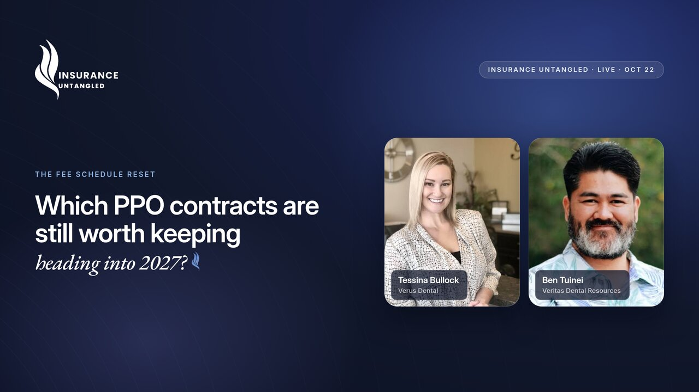
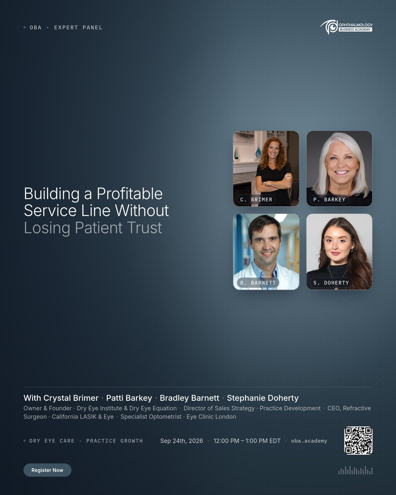
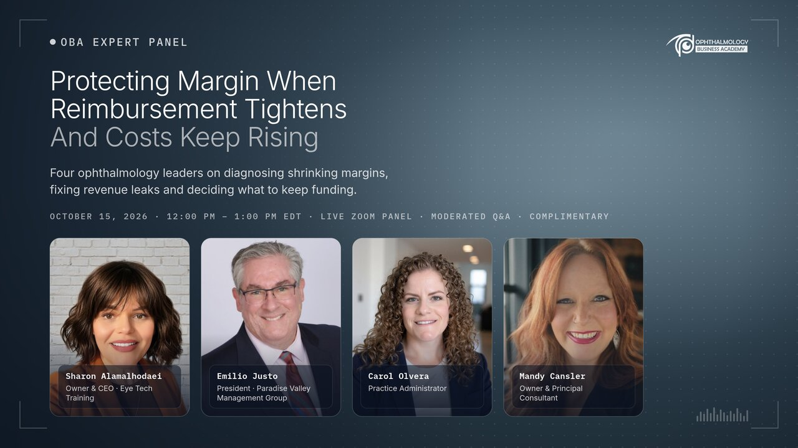

# Stencil

One asset engine with brand packs. Pick a format and a brand, and Stencil renders the layered
Canva SVG plus the PNG (and a vector PDF for decks), with the same output names the old tools
used. It replaces seven generator repos: `zoom-banner`, `iu-zoom-banner`, `podcast-thumbnails`,
`iu-podcast-thumbnails`, `panel-social-posts`, `iu-panel-social-posts` and `g-slides`.

Adding a brand is one file in `brands/`, not a forked repo.

## What it looks like

Same engine, two brand packs. IU on top, OBA below.

| Social post | Thumbnail or deck |
|---|---|
|  |  |
|  |  |

## Quick start

```bash
npm install                       # one dependency set for every format
node scripts/import.mjs           # copy fonts, logos, photos, panelists, QRs and inputs from the forks
node stencil.mjs --help           # formats and brands
node stencil.mjs banner oct-22-fee-schedule-reset
node stencil.mjs deck sep24-dry-eye-growth
```

Chrome is the system `google-chrome-stable`; Playwright and sharp come from `node_modules`.

## Formats

| Format | Inputs | Outputs (frozen names) | Designs |
|---|---|---|---|
| `banner` | `panels/<name>.toml` | `out/<stem>.png` (640x200), `out/<stem>@3x.png`, `canva/<stem>.svg` | `strip-centre` (OBA), `strip-corner` (IU) |
| `thumb` | `episodes/<name>.toml` | `canva/<OBA or IU>-<name>.svg`, `preview/<name>.png` (2560x1440) | `classic` (OBA), `cards` (IU) |
| `social` | `posts/<name>.toml` | `canva/<stem>-<fmt>.svg`, `out/<stem>-<fmt>@2x.png`, or `<campaign>/<person or shared>/<fmt>/` | `classic` (OBA), `scene` (IU) |
| `deck` | `decks/<name>.toml` | `canva/<deck>/NN-<type>.svg`, `out/<deck>/NN-<type>@2x.png`, `out/<deck>.pdf` | `deck` |
| `background` | none | `canva/host-background.svg`, `out/host-background.png`, `.jpg` | `host` |

Every format also writes `.gen/<name>.json`, the normalized sidecar a publishing step can read
without parsing SVG. One input name belongs to one format (the sidecar folder is shared).

Each format keeps the flags of the tool it replaced (`--svg-only`, `--count`, `--speakers`,
`--formats`, `--slides`, `--no-pdf`, `--watch`, ...), plus `--brand <id>`, which beats the
file's `brand`, which beats the default, IU. `node stencil.mjs <format> --help` prints them.
`--list --json` and `<name> --emit-json` are the machine contract the GUI uses.

## Brands

| Pack | Status | Designs |
|---|---|---|
| `IU`, `IU_LIGHT` | active | banner, thumb, social (IU also a colours-only deck) |
| `OBA` | legacy (retired 2026-09-28; IU reuses the machinery) | banner, thumb, social, deck, background |
| `OBA_LIGHT` | legacy | social |
| `VET` | legacy (archived VBI work) | banner, social |

A pack (`brands/<id>.mjs`) is data. Base `tokens` hold the palette, logo and wordmark; each
format entry names the design it uses and may override tokens for that surface:

```js
export default {
  id: "ACME",
  label: "Acme Panels",
  status: "active",
  tokens: { id: "ACME", label: "Acme Panels", wordmark: "ACME", logo: "acme-logo.svg",
            gradient: [["#0E2A3B", 0], ["#08131C", 100]], glow: "rgba(80,160,200,0.3)", /* ... */ },
  formats: {
    banner: { layout: "strip-corner",
              tokens: { logoH: 22, strip: { tone: "dark", lobeA: { color: "#50A0C8", alpha: 0.3 },
                        lobeB: { color: "#3A6E8C", alpha: 0.2 }, pace: false,
                        logoLayer: ["acme-logo", "ACME logo"], label: "ACME" } } },
  },
};
```

Drop the logo in `assets/logos/`, run `node stencil.mjs banner <name> --brand ACME`, and look.
Token order: brand base, then the format override, then the design's own defaults. Every
override carries a comment saying why it exists (see the deck's dots grid in `brands/oba.mjs`).
No format code ever tests a brand id; a design reads tokens.

## Workspace

Inputs, photos, panelists, QR codes and every output are content, and stay local (gitignored).
They live in the Stencil folder by default; `STENCIL_WORKSPACE=/path` moves them (fonts, logos
and code stay in the repo). Photos resolve from `assets/headshots/` by file name; a missing
photo becomes a monogram, a missing QR an empty frame, never a crash.

## GUI

```bash
node gui.mjs banner          # also: thumb, social, deck
NO_OPEN=1 node gui.mjs deck  # headless: prints the URL and the write token
```

The GUI is the vendored `panel-kit` (unchanged; `panel-kit/docs/CONTRACT.md`). Vendor it into
Stencil only with `node ../panel-kit/scripts/vendor.mjs stencil`: run without a target, that
script overwrites every tool's copy, including the forks' customized ones.

## The parity gate

```bash
node parity/run.mjs banner thumb social deck background
```

Each run copies the forks to a scratch folder, renders every real input through the fork and
through Stencil, and compares file by file: sidecars by value (asset paths mapped to file
names), SVGs as text, PNGs pixel by pixel, PDFs by page count and embedded fonts. The report is
`.parity/report.md`; `.parity/look/<format>/` holds golden | Stencil | difference images for a
person to look at. The forks are never written to.

`node scripts/verify-moves.mjs` proves every file moved from a fork is still the fork's code
apart from its declared import and path rewrites (`scripts/moves/<format>.json`).

## Status

Built 2026-10-05. Every real input in the seven forks renders through Stencil with the same
files the fork writes, byte for byte (`node parity/run.mjs`, 2026-10-05):

| Format | Real inputs | Files compared | Result |
|---|---|---|---|
| banner | 5 panels | 20 | all exact |
| thumb | 82 episodes (78 OBA, 4 IU) | 246 | all exact |
| social | 52 posts (30 OBA, 22 IU), every requested size | 316 | all exact |
| deck | 3 decks | 51 | all exact |
| background | 1 | 3 | all exact |

Known behaviour carried over from the forks, not introduced here:

- The Sept 17 Referral Growth deck fails its own overflow check on slide 7 (a stat label meets
  the role line), in g-slides and in Stencil alike. Shorten that copy to get its PNGs and PDF.
- The OBA thumbnail and social templates load fonts from Google Fonts. Under heavy machine
  load Chrome can lay text out a fraction of a pixel differently, so the OBA thumbnail keeps the
  PNG two browser sessions agree on, and both renderers retry once after a stalled page load.
  Local fonts would remove this at the root but change pixels, so that waits for a look.

No fork is retired yet: each fork retires after its format's contact
sheets (`.parity/look/README.md`) have had a person's look. See `tasks/todo.md` and
`.d/decisions.tsv` for what was decided along the way and why.
